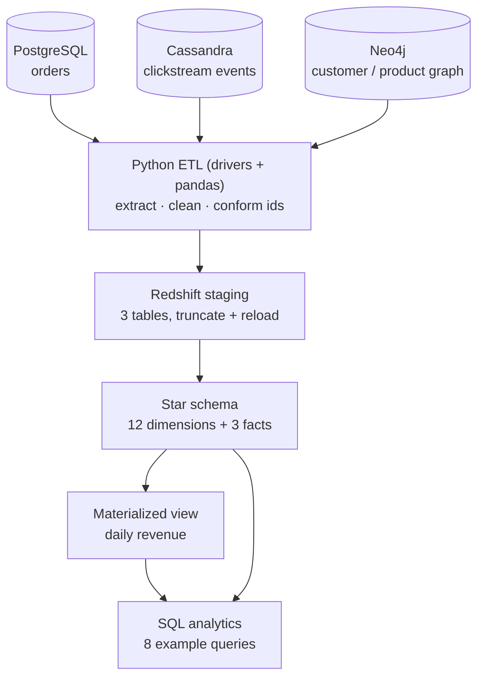
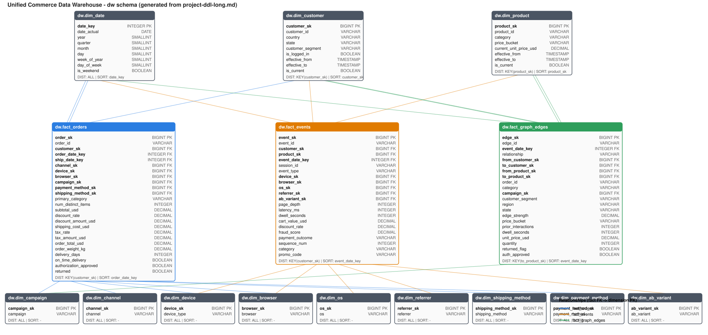

# Unified E-commerce Data Warehouse — PostgreSQL, Cassandra & Neo4j to Amazon Redshift

[](https://github.com/adebowalep/redshift-multi-source-ecommerce-warehouse/actions/workflows/ci.yml)


An e-commerce company stores **orders**, **user events** and **product relationships** in three different database technologies. This
project integrates them into one dimensional warehouse on Amazon Redshift, so that revenue, behaviour and product questions can be answered
with consistent SQL. It is an educational project built on Udacity course material (see [Attribution](#attribution-and-licensing)).

> **CI status.** A GitHub Actions workflow is configured (`.github/workflows/ci.yml`), but at the time of writing it has **not run on GitHub**
> (the hardening work is committed locally and has not been pushed). The badge above shows "no status" until it does. Do not read it as a pass.

## Key results (historical Redshift run, 2026-11-12)

| Metric | Result | Source |
|---|---|---|
| Operational source systems | 3 | PostgreSQL, Cassandra, Neo4j |
| Source records | 7,500 (2,500 each) | `reports/validation-results.md` |
| Dimension tables / rows | 12 / 11,009 | `reports/pipeline_log.csv` |
| Fact tables / rows | 3 / 7,500 | `reports/validation-results.md` |
| Records lost or added between CSV and fact | 0 (counts and control totals reconcile) | reconciliation table in the report |
| Data-quality checks | 27 of 27 passed | `reports/warehouse_report.md` section 7 |
| Materialized view `dw.mv_daily_revenue` | 542 rows, 0 differences from a fresh aggregation | report section 8 |
| Fact-to-dimension joins without redistribution | 3 of 3 (`DS_DIST_NONE`) | report section 8 |
| Measured materialized-view speed-up | **1.14x** in the final run on a 2,500-row table (earlier runs: 1.10x–1.15x, i.e. noise level) | report section 8 |

These numbers were produced by the notebook version preserved in [`evidence/`](evidence/starter.executed-2026-11-12.ipynb). The notebook in the
repository root was revised afterwards (see [Testing and verification](#testing-and-verification)).

## Architecture



## Technology stack

| Tool | Role in this project |
|---|---|
| PostgreSQL | transactional source of orders (`psycopg2`, SQLAlchemy) |
| Apache Cassandra | source of clickstream events (`cassandra-driver`) |
| Neo4j | source of customer and product relationships (`neo4j` driver, Cypher `MERGE`) |
| Python, pandas | extraction, type coercion, identifier standardisation, validation |
| Amazon Redshift | analytical warehouse: `DISTKEY`/`SORTKEY`/`ENCODE`, materialized view, `ANALYZE` |
| Redshift Data API (`boto3`) | executes all SQL: polling, paging, timeout/cancel, expired-credential detection |
| SQL | dimensional loads, update statements, 27 data-quality checks, analytics |
| pytest, sqlglot | regression tests, SQL syntax checks (Redshift dialect) |
| GitHub Actions | offline test workflow (configured, not yet run) |

## Data sources

Three CSV files of 2,500 rows each, supplied with the course, stand in for the production systems and are loaded into real PostgreSQL,
Cassandra and Neo4j instances by the notebook before extraction.

| System | File | Grain | Key |
|---|---|---|---|
| PostgreSQL | `data/ecom_orders_postgres.csv` | one row per order | `order_id` |
| Cassandra | `data/ecom_events_cassandra.csv` | one row per clickstream event | `event_id` |
| Neo4j | `data/ecom_graph_edges_neo4j.csv` | one relationship per edge | `edge_id` |

`customer_id` (`C#####`) and `product_id` (`P####`) share one format across the systems and become the natural keys of `dim_customer` and
`dim_product`. Graph nodes are routed to a dimension by their **node type**, never by the shape of the id. The mapping of all 73 source
columns is in [`reports/field-mapping.md`](reports/field-mapping.md).

## Dimensional model



3 staging tables, 12 dimensions (`dim_date`, `dim_customer`, `dim_product` and nine small lookup dimensions) and 3 facts (`fact_orders`,
`fact_events`, `fact_graph_edges`). Surrogate keys are `IDENTITY` columns. `dim_customer` and `dim_product` are `DISTKEY` on their surrogate
key, like the facts that join them, so those joins are colocated; the small dimensions are `DISTSTYLE ALL`. Every fact is sorted by its date key.
The editable diagram source is [`project-mermaid-diagram.md`](project-mermaid-diagram.md); the DDL (with a change log of corrections to the
supplied file) is [`project-ddl-long.md`](project-ddl-long.md).

**Logical names vs physical names.** The design and the diagram use the logical names `stg.orders_raw` and `dw.fact_orders` (the diagram
writes `dw_fact_orders`). The Udacity lab user could not run `CREATE SCHEMA`, so in the recorded run every table was physically named
`public.stg_<table>` / `public.dw_<table>` (for example `public.dw_fact_orders`). The notebook rewrites every statement consistently and
never mixes the two conventions; the report states which one was used.

**Dimension history.** The customer and product dimensions have `effective_from`, `effective_to` and `is_current`, but only one current row per
key is kept and a changed attribute is overwritten (Type 1). The schema is *SCD Type 2-ready*; **historical version tracking is not implemented.**

## Pipeline implementation

1. **Load sources** — CSV into PostgreSQL (upsert), Cassandra (prepared statements, upserts) and Neo4j (`UNWIND` + `MERGE`, whitelisted labels and relationship types).
2. **Extract** — query each system back and compare cell by cell with the CSV.
3. **Transform** — drift check, typed conversion, trimming and case rules, id validation, duplicate and NULL-key rejection, rounding to the DDL precision.
4. **Warehouse DDL** — controlled by `PIPELINE_MODE` (below).
5. **Stage** — Redshift Data API batched `INSERT`s into truncated staging tables, row counts verified.
6. **Dimensions and facts** — set-based SQL; changed rows are updated, new keys inserted.
7. **Optimise and validate** — `ANALYZE`, materialized view, `EXPLAIN` evidence, reconciliation, 27 checks, 8 analytical queries, generated report.

**Execution modes** (`PIPELINE_MODE`, default `INITIALIZE`):

| Mode | What it does |
|---|---|
| `INITIALIZE` | creates only the project tables that are missing; **never drops anything**; safe to re-run |
| `LOAD` | the tables must already exist; the DDL step executes nothing |
| `REBUILD` | drops and re-creates every project table. Refused unless the database is listed in `REBUILD_ALLOWED_DATABASES` **and** `REBUILD_CONFIRM` is exactly `REBUILD <database>` |

**What a re-run does** (the revised notebook; tested on a PostgreSQL emulation, not yet on Redshift):

| Situation | Behaviour |
|---|---|
| Unchanged source data | nothing is written; surrogate keys and row versions stay the same |
| New order / event / edge | inserted once |
| Corrected value in an existing record | the fact row is updated in place; a changed customer/product attribute is overwritten (Type 1) |
| Dependent objects | an update does not refresh the materialized view by itself; the notebook drops, recreates and refreshes it in Task 5 |
| Record removed from the source | **not deleted.** The load stops with an explicit error ("facts without a staging row") |
| Interrupted staging load | detected before any fact is touched (staging row counts are compared first); a re-run recovers |
| Two records with the same timestamp | the one with the higher record id wins, so the result does not depend on row order |

This is a safe, repeatable batch load with support for corrections. It is **not** CDC, not streaming and not incremental in the sense of loading only deltas.

## Engineering challenges

- Conforming three data models (relational, wide-column, graph) on shared `customer_id` / `product_id` keys, and routing graph endpoints by node type.
- Correcting the supplied DDL: the dimensions were distributed on business keys while the facts join on surrogate keys, so the documented colocated joins were not colocated.
- Working around lab restrictions (no `CREATE SCHEMA`, no `svv_*` views) with a consistent naming fallback and `pg_catalog` queries.
- Redshift does not enforce primary or foreign keys, so integrity is checked explicitly (27 queries, each shown by a test to be able to fail).
- Finding, after submission, that a re-run dropped populated tables and that corrections never reached the facts; see the [engineering audit](reports/01-engineering-audit.md).

## Testing and verification

| Environment | What was verified | Evidence |
|---|---|---|
| **Historical execution** (Udacity AWS workspace, 2026-11-12) | the **original** notebook, end to end, on real PostgreSQL, Cassandra, Neo4j and Redshift | `evidence/starter.executed-2026-11-12.ipynb` (36 of 36 code cells executed, 0 error outputs), `reports/`, `screenshots/` (rendered from an earlier clean run of the same code) |
| **Local tests** (macOS, Python 3.13, PostgreSQL 17) | 195 tests pass: transformations, Data API helper behaviour (scripted fake client), source loaders, setup modes and rebuild guard, warehouse semantics, negative controls, SQL parsing, diagram check, consistency of the recorded evidence. 14 deliberate code mutations were all caught (`scripts/mutation_check.py`). | `tests/` |
| **Automated CI** | workflow configured, **not run on GitHub yet** | `.github/workflows/ci.yml` |
| **Not verified** | the code changed after the recorded run has **not been run on Amazon Redshift**: `UPDATE ... FROM`, `WITH ... UPDATE`, the changed `INSERT ... SELECT FROM (subquery)` forms, the `pg_tables` mode detection and the new `PIPELINE_MODE` flow. They are parsed as Redshift SQL (sqlglot) and executed on PostgreSQL only. Cassandra and Neo4j correction semantics were analysed, not executed (see limitations). | `reports/01-engineering-audit.md` |

The revised notebook's saved outputs were cleared because its code no longer matches the recorded run; the reports in `reports/` still
describe the recorded run.

Run the tests (no AWS needed; a local PostgreSQL provides the emulation, otherwise those tests are skipped):

```bash
python -m pip install -r requirements-dev.txt
python -m pytest
```

## Analytics and performance results

Eight analytical queries (daily revenue from the materialized view, revenue by channel and by payment method, an A/B funnel, referrer
engagement, category performance across orders and graph, co-purchase candidates, customers present in both orders and events) are in report
section 9. The materialized-view read was 1.14x faster than the base aggregation (medians of 6 timed runs, result cache bypassed) on 2,500
rows: both take about 50 ms, so this shows **direction only** and says nothing about larger data. Batched `INSERT`s are used because the project
supplies them; for large loads `COPY` from S3 is the appropriate approach and was not implemented.

## Reproduction

**Udacity workspace (full pipeline; needs the lab's PostgreSQL, Cassandra, Neo4j and Redshift):** open the folder, set the lab credentials
(environment variables, or the hidden prompt in the credentials cell), set `REDSHIFT_WORKGROUP`, `REDSHIFT_DATABASE`, `REDSHIFT_SECRET_ARN`, then
Restart & Run All. The default `PIPELINE_MODE=INITIALIZE` never drops tables. To start over in a disposable database:
`PIPELINE_MODE=REBUILD REBUILD_ALLOWED_DATABASES=<db> REBUILD_CONFIRM="REBUILD <db>"`.

**Offline:** `python -m pytest` (see above). No AWS account is required or used.

## Known limitations

- Educational data set; 2,500 rows per source, so timings are noise-level and say nothing about production scale.
- Batched `INSERT` loading instead of S3 `COPY`.
- Only a small share of customers appears in more than one system (72 customers have both orders and events), so cross-source behavioural analysis covers just those customers; there is no full-funnel attribution.
- No CDC and no deletes: removed source records stop the load. Corrections are applied only as Type 1 overwrites.
- SCD Type 2 history is not implemented (the schema is ready for it).
- Cassandra loads missing values as "unset" and Neo4j updates use `SET e += props`, so a correction **to NULL** does not clear an old value there; a correction that changes a Cassandra key column or a Neo4j edge's endpoints creates a second record that the transformation rejects as a duplicate. Analysed, not executed.
- The changes made after the recorded run are not verified on Redshift (see above); the screenshots come from an earlier run of the same code.
- Redistribution rights of the supplied course material are unverified ([PROVENANCE.md](PROVENANCE.md)).

## Repository structure

```
starter.ipynb                         the pipeline (revised, outputs cleared)
evidence/                             the notebook exactly as executed in the Udacity workspace
data/                                 the three source CSVs (course-supplied)
project-ddl-long.md                   Redshift DDL (+ change log)
project-mermaid-diagram.md            ER diagram source
reports/                              generated report, validation, pipeline log, field mapping, diagram, audits
screenshots/                          9 images of notebook outputs (earlier run of the same code)
tests/                                pytest suite (+ fakes for the Data API and a throw-away PostgreSQL)
scripts/                              diagram renderer, defect reproductions, mutation check
.github/workflows/ci.yml              offline CI
```

## Documentation and evidence

| What | Where |
|---|---|
| Final report generated by the notebook | [`reports/warehouse_report.md`](reports/warehouse_report.md) |
| Data-quality and reconciliation results | [`reports/validation-results.md`](reports/validation-results.md) |
| Stage-by-stage execution log | [`reports/pipeline_log.csv`](reports/pipeline_log.csv) |
| Field mapping | [`reports/field-mapping.md`](reports/field-mapping.md) |
| Engineering audit (reproduced defects, fixes, open items) | [`reports/01-engineering-audit.md`](reports/01-engineering-audit.md) |
| Historical documents (labelled) | [`reports/00-project-audit.md`](reports/00-project-audit.md), [`reports/rubric-checklist.md`](reports/rubric-checklist.md) |
| Executed notebook of the recorded run | [`evidence/`](evidence/starter.executed-2026-11-12.ipynb) |
| Screenshots | [`screenshots/`](screenshots/) |
| Tests / CI | [`tests/`](tests/), [`.github/workflows/ci.yml`](.github/workflows/ci.yml) |

## Attribution and licensing

This is a student project built on **Udacity Data Engineering course material**: the starter notebook scaffolding and task structure, the three
source CSV files, the Redshift DDL and the ER diagram source were supplied by the course; this repository modifies and extends them. The
repository currently has **no license file**, and whether the supplied material may be redistributed publicly has **not been verified**.
Nothing here is offered under an open-source license. See [PROVENANCE.md](PROVENANCE.md) for the file-by-file origin and the open question.
