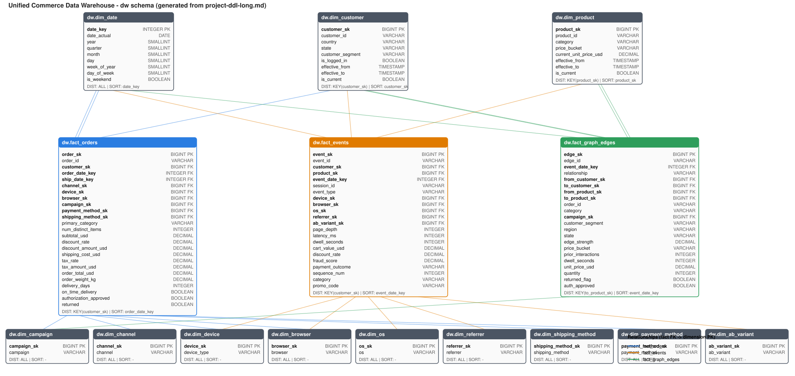

# Data Warehouse Build Report

Generated: 2026-11-12 14:14:58Z (all numbers below were produced by this run of the notebook against Amazon Redshift)

## 1. Executive Summary
An e-commerce company keeps orders in **PostgreSQL**, clickstream events in **Apache Cassandra** and customer/product
relationships in **Neo4j**, so revenue, behaviour and product questions cannot be answered consistently. This project loads the three
sources through their native Python drivers, transforms and conforms the data, stages it in **Amazon Redshift** (`stg` schema) and
builds a star schema (`dw` schema) with 12 dimensions and 3 fact tables, optimized with distribution keys, sort keys,
compression and a materialized view. Result: 7,500 fact rows loaded,
no records lost between source and fact, 27/27 data-quality checks passed.

## 2. Source Systems
| System | Content | Records | Columns |
|---|---|---|---|
| PostgreSQL | orders (raw.orders) | 2500 | 26 |
| Cassandra | clickstream events (events) | 2500 | 24 |
| Neo4j | graph edges (relationships) | 2500 | 23 |


## 3. Source-to-Target Mapping
| Source System | Source Field | Source Type | Transformation | Target Table (dw.) | Target Column |
|---|---|---|---|---|---|
| PostgreSQL | order_id | object | trim, upper-case, validate ^ORD\d+$, must be unique | fact_orders | order_id |
| PostgreSQL | customer_id | object | trim, upper-case, validate ^C\d+$ (conformed key shared by all 3 sources) | dim_customer | customer_id |
| PostgreSQL | customer_id | object | surrogate-key lookup (current row) | fact_orders | customer_sk |
| PostgreSQL | order_datetime | object | parse timestamp; derive YYYYMMDD | fact_orders | order_date_key (-> dim_date.date_key) |
| PostgreSQL | ship_datetime | object | parse timestamp; derive YYYYMMDD | fact_orders | ship_date_key (-> dim_date.date_key) |
| PostgreSQL | order_datetime/ship_datetime | - | distinct dates | dim_date | date_actual, year, quarter, month, day, week_of_year, day_of_week, is_weekend |
| PostgreSQL | channel | object | trim, lower-case; distinct -> surrogate key | dim_channel / fact_orders | channel / channel_sk |
| PostgreSQL | device_type | object | trim, lower-case; distinct -> surrogate key | dim_device / fact_orders | device_type / device_sk |
| PostgreSQL | browser | object | trim; distinct -> surrogate key | dim_browser / fact_orders | browser / browser_sk |
| PostgreSQL | country, state | - | trim, upper-case; customer geography (orders take precedence over events) | dim_customer | country, state |
| PostgreSQL | payment_method | object | trim, lower-case; distinct -> surrogate key | dim_payment_method / fact_orders | payment_method / payment_method_sk |
| PostgreSQL | campaign | object | trim; NULL stays NULL; distinct -> surrogate key | dim_campaign / fact_orders | campaign / campaign_sk |
| PostgreSQL | shipping_method | object | trim, lower-case; distinct -> surrogate key | dim_shipping_method / fact_orders | shipping_method / shipping_method_sk |
| PostgreSQL | primary_category | object | trim (degenerate attribute) | fact_orders | primary_category |
| PostgreSQL | num_distinct_items | int64 | numeric/boolean conversion; rounded to DDL precision | fact_orders | num_distinct_items |
| PostgreSQL | subtotal_usd | float64 | numeric/boolean conversion; rounded to DDL precision | fact_orders | subtotal_usd |
| PostgreSQL | discount_rate | float64 | numeric/boolean conversion; rounded to DDL precision | fact_orders | discount_rate |
| PostgreSQL | discount_amount_usd | float64 | numeric/boolean conversion; rounded to DDL precision | fact_orders | discount_amount_usd |
| PostgreSQL | shipping_cost_usd | float64 | numeric/boolean conversion; rounded to DDL precision | fact_orders | shipping_cost_usd |
| PostgreSQL | tax_rate | float64 | numeric/boolean conversion; rounded to DDL precision | fact_orders | tax_rate |
| PostgreSQL | tax_amount_usd | float64 | numeric/boolean conversion; rounded to DDL precision | fact_orders | tax_amount_usd |
| PostgreSQL | order_total_usd | float64 | numeric/boolean conversion; rounded to DDL precision | fact_orders | order_total_usd |
| PostgreSQL | order_weight_kg | float64 | numeric/boolean conversion; rounded to DDL precision | fact_orders | order_weight_kg |
| PostgreSQL | delivery_days | int64 | numeric/boolean conversion; rounded to DDL precision | fact_orders | delivery_days |
| PostgreSQL | on_time_delivery | bool | numeric/boolean conversion; rounded to DDL precision | fact_orders | on_time_delivery |
| PostgreSQL | authorization_approved | bool | numeric/boolean conversion; rounded to DDL precision | fact_orders | authorization_approved |
| PostgreSQL | returned | bool | numeric/boolean conversion; rounded to DDL precision | fact_orders | returned |
| Cassandra | event_id | object | trim, upper-case, validate ^EVT\d+$, unique | fact_events | event_id |
| Cassandra | customer_id | object | trim, upper-case, validate ^C\d+$ | dim_customer | customer_id |
| Cassandra | customer_id | object | surrogate-key lookup | fact_events | customer_sk |
| Cassandra | session_id | object | trim, upper-case | fact_events | session_id |
| Cassandra | event_type | object | trim, lower-case | fact_events | event_type |
| Cassandra | event_ts | object | parse timestamp; derive YYYYMMDD | fact_events | event_date_key (-> dim_date.date_key) |
| Cassandra | device_type | object | trim, lower-case; distinct -> surrogate key | dim_device / fact_events | device_type / device_sk |
| Cassandra | browser | object | trim; distinct -> surrogate key | dim_browser / fact_events | browser / browser_sk |
| Cassandra | os | object | trim; distinct -> surrogate key | dim_os / fact_events | os / os_sk |
| Cassandra | referrer | object | trim, lower-case; distinct -> surrogate key | dim_referrer / fact_events | referrer / referrer_sk |
| Cassandra | country, state | - | fallback customer geography when no order exists | dim_customer | country, state |
| Cassandra | ab_variant | object | trim, upper-case; distinct -> surrogate key | dim_ab_variant / fact_events | ab_variant / ab_variant_sk |
| Cassandra | is_logged_in | bool | boolean conversion; latest event per customer | dim_customer | is_logged_in |
| Cassandra | product_id | object | trim, upper-case, validate ^P\d+$; surrogate-key lookup (NULL when event has no product) | dim_product / fact_events | product_id / product_sk |
| Cassandra | category | object | trim; latest per product | dim_product / fact_events | category / category |
| Cassandra | page_depth | int64 | numeric conversion / lower-case (payment_outcome) / upper-case (promo_code) | fact_events | page_depth |
| Cassandra | latency_ms | int64 | numeric conversion / lower-case (payment_outcome) / upper-case (promo_code) | fact_events | latency_ms |
| Cassandra | dwell_seconds | int64 | numeric conversion / lower-case (payment_outcome) / upper-case (promo_code) | fact_events | dwell_seconds |
| Cassandra | cart_value_usd | float64 | numeric conversion / lower-case (payment_outcome) / upper-case (promo_code) | fact_events | cart_value_usd |
| Cassandra | discount_rate | float64 | numeric conversion / lower-case (payment_outcome) / upper-case (promo_code) | fact_events | discount_rate |
| Cassandra | fraud_score | float64 | numeric conversion / lower-case (payment_outcome) / upper-case (promo_code) | fact_events | fraud_score |
| Cassandra | payment_outcome | object | numeric conversion / lower-case (payment_outcome) / upper-case (promo_code) | fact_events | payment_outcome |
| Cassandra | sequence_num | int64 | numeric conversion / lower-case (payment_outcome) / upper-case (promo_code) | fact_events | sequence_num |
| Cassandra | promo_code | object | numeric conversion / lower-case (payment_outcome) / upper-case (promo_code) | fact_events | promo_code |
| Neo4j | edge_id | object | relationship property; trim, upper-case, validate ^EDGE\d+$, unique | fact_graph_edges | edge_id |
| Neo4j | from_node_id + from_node_type | - | type=Customer -> customer_sk lookup; type=Product -> product_sk lookup | fact_graph_edges | from_customer_sk / from_product_sk |
| Neo4j | to_node_id + to_node_type | - | type=Customer -> customer_sk lookup; type=Product -> product_sk lookup | fact_graph_edges | to_customer_sk / to_product_sk |
| Neo4j | from_node_id / to_node_id (Customer nodes) | - | distinct customer ids | dim_customer | customer_id |
| Neo4j | from_node_id / to_node_id / product_id (Product nodes) | - | distinct product ids | dim_product | product_id |
| Neo4j | relationship | object | upper-case, whitelisted relationship type | fact_graph_edges | relationship |
| Neo4j | timestamp | object | parse timestamp; derive YYYYMMDD | fact_graph_edges | event_date_key (-> dim_date.date_key) |
| Neo4j | order_id | object | trim, upper-case; NULL when no order (kept as degenerate key) | fact_graph_edges | order_id |
| Neo4j | category | object | trim | fact_graph_edges / dim_product | category |
| Neo4j | customer_segment | object | trim; latest per customer (Customer source nodes) | dim_customer / fact_graph_edges | customer_segment |
| Neo4j | price_bucket | object | trim; latest per product | dim_product / fact_graph_edges | price_bucket |
| Neo4j | unit_price_usd | float64 | numeric conversion; latest per product -> current_unit_price_usd | dim_product / fact_graph_edges | current_unit_price_usd / unit_price_usd |
| Neo4j | campaign | object | trim; distinct -> surrogate key | dim_campaign / fact_graph_edges | campaign / campaign_sk |
| Neo4j | edge_strength | float64 | type conversion | fact_graph_edges | edge_strength |
| Neo4j | region | object | type conversion | fact_graph_edges | region |
| Neo4j | state | object | type conversion | fact_graph_edges | state |
| Neo4j | prior_interactions | int64 | type conversion | fact_graph_edges | prior_interactions |
| Neo4j | dwell_seconds | int64 | type conversion | fact_graph_edges | dwell_seconds |
| Neo4j | quantity | int64 | type conversion | fact_graph_edges | quantity |
| Neo4j | returned_flag | bool | type conversion | fact_graph_edges | returned_flag |
| Neo4j | auth_approved | bool | type conversion | fact_graph_edges | auth_approved |
| Neo4j | same_household | bool | boolean conversion | stg.edges_raw only | same_household (not carried into the fact: no DDL column) |


**ID standardization:** customer_id (`C#####`) and product_id (`P####`) share one format across the systems, so they are trimmed,
upper-cased, pattern-validated and used as the natural keys of `dim_customer` / `dim_product`. Graph node ids are routed by
`*_node_type` (Customer -> dim_customer, Product -> dim_product), never assumed to be customers. `order_id` links orders and graph edges.
Missing optional keys stay NULL; missing critical keys abort the load.

## 4. Dimensional Schema
**Naming note:** this database user is not allowed to create schemas, so every logical name `stg.<table>` / `dw.<table>` used in this report is physically stored as `public.stg_<table>` / `public.dw_<table>` (for example `dw.fact_orders` is `public.dw_fact_orders`). The mapping was applied to every statement, never mixed.

| schema | table | kind | n_cols | diststyle | distkey | sortkey |
|---|---|---|---|---|---|---|
| stg | orders_raw | staging | 26 | AUTO/EVEN | None | None |
| stg | events_raw | staging | 24 | AUTO/EVEN | None | None |
| stg | edges_raw | staging | 23 | AUTO/EVEN | None | None |
| dw | dim_date | dimension | 9 | ALL | None | date_key |
| dw | dim_customer | dimension | 9 | KEY | customer_sk | customer_sk |
| dw | dim_product | dimension | 8 | KEY | product_sk | product_sk |
| dw | dim_campaign | dimension | 2 | ALL | None | None |
| dw | dim_channel | dimension | 2 | ALL | None | None |
| dw | dim_device | dimension | 2 | ALL | None | None |
| dw | dim_browser | dimension | 2 | ALL | None | None |
| dw | dim_os | dimension | 2 | ALL | None | None |
| dw | dim_referrer | dimension | 2 | ALL | None | None |
| dw | dim_shipping_method | dimension | 2 | ALL | None | None |
| dw | dim_payment_method | dimension | 2 | ALL | None | None |
| dw | dim_ab_variant | dimension | 2 | ALL | None | None |
| dw | fact_orders | fact | 25 | KEY | customer_sk | order_date_key |
| dw | fact_events | fact | 22 | KEY | customer_sk | event_date_key |
| dw | fact_graph_edges | fact | 22 | KEY | to_product_sk | event_date_key |


**Grain:** `fact_orders` = one row per order; `fact_events` = one row per clickstream event; `fact_graph_edges` = one row per graph edge.
**Surrogate keys:** `IDENTITY` columns (`customer_sk`, `product_sk`, `channel_sk`, ...); `dim_date.date_key` = YYYYMMDD.
**SCD:** customer/product dimensions carry `effective_from/effective_to/is_current` and are loaded as one current row per key
(Type-2 ready, not full history tracking).

## 5. Schema Diagram

```mermaid
erDiagram
    %% =========================
    %% DIMENSIONS
    %% =========================
    dw_dim_date {
      INT date_key PK "yyyymmdd"
      DATE date_actual
      SMALLINT year
      SMALLINT quarter
      SMALLINT month
      SMALLINT day
      SMALLINT week_of_year
      SMALLINT day_of_week
      BOOLEAN is_weekend
    }

    dw_dim_customer {
      BIGINT customer_sk PK
      VARCHAR customer_id
      VARCHAR country
      VARCHAR state
      VARCHAR customer_segment
      BOOLEAN is_logged_in
      TIMESTAMP effective_from
      TIMESTAMP effective_to
      BOOLEAN is_current
    }

    dw_dim_product {
      BIGINT product_sk PK
      VARCHAR product_id
      VARCHAR category
      VARCHAR price_bucket
      DECIMAL current_unit_price_usd
      TIMESTAMP effective_from
      TIMESTAMP effective_to
      BOOLEAN is_current
    }

    dw_dim_campaign    { BIGINT campaign_sk PK  VARCHAR campaign }
    dw_dim_channel     { BIGINT channel_sk  PK  VARCHAR channel }
    dw_dim_device      { BIGINT device_sk   PK  VARCHAR device_type }
    dw_dim_browser     { BIGINT browser_sk  PK  VARCHAR browser }
    dw_dim_os          { BIGINT os_sk       PK  VARCHAR os }
    dw_dim_referrer    { BIGINT referrer_sk PK  VARCHAR referrer }
    dw_dim_shipping_method  { BIGINT shipping_method_sk PK VARCHAR shipping_method }
    dw_dim_payment_method   { BIGINT payment_method_sk  PK VARCHAR payment_method }
    dw_dim_ab_variant  { BIGINT ab_variant_sk PK VARCHAR ab_variant }

    %% =========================
    %% FACTS
    %% =========================
    dw_fact_orders {
      BIGINT order_sk PK
      VARCHAR order_id
      BIGINT customer_sk FK
      INT    order_date_key FK
      INT    ship_date_key  FK
      BIGINT channel_sk FK
      BIGINT device_sk  FK
      BIGINT browser_sk FK
      BIGINT campaign_sk FK
      BIGINT payment_method_sk FK
      BIGINT shipping_method_sk FK
      VARCHAR primary_category
      INT    num_distinct_items
      DECIMAL subtotal_usd
      DECIMAL discount_rate
      DECIMAL discount_amount_usd
      DECIMAL shipping_cost_usd
      DECIMAL tax_rate
      DECIMAL tax_amount_usd
      DECIMAL order_total_usd
      DECIMAL order_weight_kg
      INT    delivery_days
      BOOLEAN on_time_delivery
      BOOLEAN authorization_approved
      BOOLEAN returned
    }

    dw_fact_events {
      BIGINT event_sk PK
      VARCHAR event_id
      BIGINT customer_sk FK
      BIGINT product_sk  FK
      INT    event_date_key FK
      VARCHAR session_id
      VARCHAR event_type
      BIGINT device_sk   FK
      BIGINT browser_sk  FK
      BIGINT os_sk       FK
      BIGINT referrer_sk FK
      BIGINT ab_variant_sk FK
      INT    page_depth
      INT    latency_ms
      INT    dwell_seconds
      DECIMAL cart_value_usd
      DECIMAL discount_rate
      DECIMAL fraud_score
      VARCHAR payment_outcome
      INT    sequence_num
      VARCHAR category
      VARCHAR promo_code
    }

    dw_fact_graph_edges {
      BIGINT edge_sk PK
      VARCHAR edge_id
      INT    event_date_key FK
      VARCHAR relationship

      BIGINT from_customer_sk FK
      BIGINT to_customer_sk   FK
      BIGINT from_product_sk  FK
      BIGINT to_product_sk    FK

      VARCHAR order_id
      VARCHAR category
      BIGINT  campaign_sk FK
      VARCHAR customer_segment
      VARCHAR region
      VARCHAR state

      DECIMAL edge_strength
      VARCHAR price_bucket
      INT     prior_interactions
      INT     dwell_seconds
      DECIMAL unit_price_usd
      INT     quantity
      BOOLEAN returned_flag
      BOOLEAN auth_approved
    }

    %% =========================
    %% RELATIONSHIPS
    %% =========================
    dw_dim_date ||--o{ dw_fact_orders : "order_date_key"
    dw_dim_date ||--o{ dw_fact_orders : "ship_date_key"
    dw_dim_date ||--o{ dw_fact_events : "event_date_key"
    dw_dim_date ||--o{ dw_fact_graph_edges : "event_date_key"

    dw_dim_customer ||--o{ dw_fact_orders : "customer_sk"
    dw_dim_customer ||--o{ dw_fact_events : "customer_sk"
    dw_dim_customer ||--o{ dw_fact_graph_edges : "from_customer_sk"
    dw_dim_customer ||--o{ dw_fact_graph_edges : "to_customer_sk"

    dw_dim_product ||--o{ dw_fact_events : "product_sk"
    dw_dim_product ||--o{ dw_fact_graph_edges : "from_product_sk"
    dw_dim_product ||--o{ dw_fact_graph_edges : "to_product_sk"

    dw_dim_campaign ||--o{ dw_fact_orders : "campaign_sk"
    dw_dim_campaign ||--o{ dw_fact_graph_edges : "campaign_sk"

    dw_dim_channel ||--o{ dw_fact_orders : "channel_sk"

    dw_dim_device ||--o{ dw_fact_orders : "device_sk"
    dw_dim_device ||--o{ dw_fact_events : "device_sk"

    dw_dim_browser ||--o{ dw_fact_orders : "browser_sk"
    dw_dim_browser ||--o{ dw_fact_events : "browser_sk"

    dw_dim_os ||--o{ dw_fact_events : "os_sk"
    dw_dim_referrer ||--o{ dw_fact_events : "referrer_sk"
    dw_dim_ab_variant ||--o{ dw_fact_events : "ab_variant_sk"

    dw_dim_shipping_method ||--o{ dw_fact_orders : "shipping_method_sk"
    dw_dim_payment_method  ||--o{ dw_fact_orders : "payment_method_sk"
```


<details><summary>Mermaid source (matches the DDL, verified programmatically)</summary>


</details>

## 6. ETL/ELT Implementation
1. **Source loading** - CSV -> PostgreSQL (`psycopg2.extras.execute_values`, `ON CONFLICT DO NOTHING`), Cassandra (prepared statements,
   `execute_concurrent_with_args`), Neo4j (`UNWIND` + `MERGE`, whitelisted labels/relationship types, node uniqueness constraints).
2. **Extraction** - SQLAlchemy/pandas, cassandra-driver, neo4j driver; values compared cell-by-cell with the CSV.
3. **Transformation** - schema-drift check, typed conversion (timestamps, ints, floats, booleans), trimming/case rules, rounding to DDL precision,
   identifier validation, duplicate/NULL-key rejection; DataFrames match the staging column specifications.
4. **Staging** - Redshift Data API (`rs_exec`, `rs_batch_insert`); staging tables are truncated and reloaded so re-runs are safe.
5. **Dimensions/facts** - set-based SQL; every insert is guarded by NOT EXISTS so re-running adds nothing twice.
6. **Error handling/logging** - failures raise (no false success), expired AWS credentials are distinguished from SQL errors, and every stage is logged:

| stage | rows_in | rows_out | status | seconds |
|---|---|---|---|---|
| load PostgreSQL raw.orders | 2500.0 | 2500 | OK | 0.37 |
| load Cassandra events | 2500.0 | 2500 | OK | 1.62 |
| load Neo4j edges | 2500.0 | 2500 | OK | 2.24 |
| extract PostgreSQL |  | 2500 | OK | 0.06 |
| extract Cassandra |  | 2500 | OK | 0.18 |
| extract Neo4j |  | 2500 | OK | 0.33 |
| transform orders | 2500.0 | 2500 | OK | 0.07 |
| transform events | 2500.0 | 2500 | OK | 0.1 |
| transform edges | 2500.0 | 2500 | OK | 0.1 |
| execute DDL | 40.0 | 39 | OK | 53.01 |
| load stg.orders_raw | 2500.0 | 2500 | OK | 13.65 |
| load stg.events_raw | 2500.0 | 2500 | OK | 13.09 |
| load stg.edges_raw | 2500.0 | 2500 | OK | 14.41 |
| populate dimensions |  | 11009 | OK | 20.9 |
| populate fact_orders |  | 2500 | OK | 5.93 |
| populate fact_events |  | 2500 | OK | 6.2 |
| populate fact_graph_edges |  | 2500 | OK | 6.12 |
| create materialized view dw.mv_daily_revenue |  | 542 | OK | 4.27 |
| ANALYZE | 6.0 | 6 | OK | 7.8 |


## 7. Data Quality
| Dataset | Source CSV | Source DB | Extracted | Transformed | Staging | Final Fact | Status |
|---|---|---|---|---|---|---|---|
| Orders | 2500 | 2500 | 2500 | 2500 | 2500 | 2500 | PASS (no record lost or added) |
| Events | 2500 | 2500 | 2500 | 2500 | 2500 | 2500 | PASS (no record lost or added) |
| Graph edges | 2500 | 2500 | 2500 | 2500 | 2500 | 2500 | PASS (no record lost or added) |


| control total | CSV | staging | fact | match |
|---|---|---|---|---|
| orders: SUM(order_total_usd) | 1039417.69 | 1039417.69 | 1039417.69 | True |
| orders: COUNT(DISTINCT customer_id) | 2460.0 | 2460.0 | 2460.0 | True |
| events: SUM(cart_value_usd) | 164886.52 | 164886.52 | 164886.52 | True |
| events: COUNT(DISTINCT product_id) | 1276.0 | 1276.0 | 1276.0 | True |
| edges: SUM(unit_price_usd*quantity) | 506521.31 | 506521.31 | 506521.31 | True |


| check | offending rows | result |
|---|---|---|
| duplicate order_id in stg.orders_raw | 0 | PASS |
| duplicate order_id in dw.fact_orders | 0 | PASS |
| duplicate event_id in dw.fact_events | 0 | PASS |
| duplicate edge_id in dw.fact_graph_edges | 0 | PASS |
| duplicate customer_id in dim_customer | 0 | PASS |
| duplicate product_id in dim_product | 0 | PASS |
| NULL order_id / customer_sk / order_date_key in fact_orders | 0 | PASS |
| NULL event_id / customer_sk / event_date_key in fact_events | 0 | PASS |
| NULL edge_id / event_date_key in fact_graph_edges | 0 | PASS |
| fact_orders -> dim_date (order_date_key) | 0 | PASS |
| fact_orders -> dim_date (ship_date_key) | 0 | PASS |
| fact_events -> dim_date | 0 | PASS |
| fact_graph_edges -> dim_date | 0 | PASS |
| fact_orders -> dim_customer / channel / device / payment / shipping | 0 | PASS |
| fact_events with product in staging but NULL product_sk | 0 | PASS |
| fact_graph_edges: Customer from-node without from_customer_sk | 0 | PASS |
| fact_graph_edges: Product to-node without to_product_sk | 0 | PASS |
| fact_graph_edges: customer key filled on a PRODUCT node (routing error) | 0 | PASS |
| negative order_total_usd / subtotal_usd | 0 | PASS |
| shipped before ordered | 0 | PASS |
| discount_rate or tax_rate outside 0..1 | 0 | PASS |
| order total != subtotal-discount+shipping+tax (> 0.05) | 0 | PASS |
| events: negative cart value / latency / dwell | 0 | PASS |
| edges: quantity <= 0 or unit_price <= 0 | 0 | PASS |
| edges: edge_strength outside 0..1 | 0 | PASS |
| unsupported relationship type | 0 | PASS |
| edges.order_id not present in fact_orders | 0 | PASS |


Cross-source customer overlap:

| customers_with_orders | customers_with_events | customers_in_both | customers_total |
|---|---|---|---|
| 2460 | 2461 | 72 | 7057 |

Only a small share of customers appears in more than one operational system, so cross-system customer analysis covers just those customers.

## 8. Redshift Optimization
| table | distribution | sort key | justification |
|---|---|---|---|
| dw.fact_orders | KEY(customer_sk) | order_date_key | Customer-centric revenue queries; colocates with dim_customer (also DISTKEY customer_sk). Date sort key serves date-range filters/daily revenue. |
| dw.fact_events | KEY(customer_sk) | event_date_key | Clickstream is analysed per customer/session; colocated with dim_customer. Date sort key for time windows. |
| dw.fact_graph_edges | KEY(to_product_sk) | event_date_key | Edges are mostly Customer->Product; distributing on the target product colocates with dim_product (DISTKEY product_sk) for product analysis. |
| dw.dim_customer | KEY(customer_sk) | customer_sk | Large dimension; same key as the customer-distributed facts so fact.customer_sk = dim.customer_sk needs no redistribution. |
| dw.dim_product | KEY(product_sk) | product_sk | Large dimension; same key as fact_graph_edges.to_product_sk. |
| dw.dim_date | ALL | date_key | Tiny and joined by every fact: replicate to every node; sort by date_key. |
| dw.dim_channel/device/browser/os/referrer/campaign/payment_method/shipping_method/ab_variant | ALL | (none) | Tiny lookup tables (<=12 rows): DISTSTYLE ALL avoids any shuffle in star joins. |
| stg.orders_raw / events_raw / edges_raw | AUTO/EVEN | (none) | Transient landing tables, fully re-loaded each run; no join workload, so no key tuning. |


**Compression:** `ENCODE zstd` on most columns, `ENCODE raw` on leading sort-key columns.
**Materialized view:** `dw.mv_daily_revenue` (542 rows) - orders, revenue and average order value per day; identical to a fresh aggregation of `fact_orders` (0 differing rows) and refreshed with `REFRESH MATERIALIZED VIEW`.
**ANALYZE** was run on the fact tables, `dim_customer`, `dim_product` and `dim_date`.

**Measured query time (Redshift-reported, 7 runs, result cache bypassed):**

| query | rows_scanned_source | first_run_ms (incl. compile) | median_ms (runs 2-7) | min_ms |
|---|---|---|---|---|
| aggregate dw.fact_orders | 2500 | 55.2 | 54.7 | 47.5 |
| read dw.mv_daily_revenue | 542 | 48.8 | 48.1 | 35.0 |


Median speed-up of the view over the base aggregation: **1.14x**. With roughly 2,500 fact rows absolute times are tiny and noisy, so this
shows direction rather than production-scale gains.

**Join colocation (from EXPLAIN):**

| join | distribution step in plan |
|---|---|
| fact_orders JOIN dim_customer on customer_sk | DS_DIST_NONE |
| fact_events JOIN dim_customer on customer_sk | DS_DIST_NONE |
| fact_graph_edges JOIN dim_product on to_product_sk | DS_DIST_NONE |


## 9. Analytical Queries (real results from Redshift)
### Q1 Top days by revenue (materialized view)

| date_actual | orders | revenue_usd | avg_order_value |
|---|---|---|---|
| 2025-04-26 | 9 | 10005.75 | 1111.75 |
| 2024-04-27 | 11 | 8379.88 | 761.8 |
| 2025-01-05 | 8 | 7753.02 | 969.12 |
| 2024-04-17 | 9 | 7488.27 | 832.03 |
| 2025-03-14 | 7 | 7029.01 | 1004.14 |
| 2024-01-14 | 5 | 6938.24 | 1387.64 |
| 2024-09-16 | 2 | 6434.74 | 3217.37 |
| 2024-02-16 | 7 | 6055.87 | 865.12 |
| 2024-07-25 | 8 | 6023.05 | 752.88 |
| 2024-12-28 | 7 | 5970.72 | 852.96 |


### Q2 Revenue by channel

**What it answers:** Which sales channels generate the most revenue, and how do their order values and return rates compare? The query joins the order fact table to the channel dimension on `channel_sk` and aggregates per channel.

```sql
SELECT
    ch.channel,
    COUNT(*)                                   AS orders,
    ROUND(SUM(f.order_total_usd), 2)           AS revenue_usd,
    ROUND(AVG(f.order_total_usd), 2)           AS avg_order_value,
    ROUND(100.0 * SUM(CASE WHEN f.returned THEN 1 ELSE 0 END) / COUNT(*), 1) AS return_rate_pct
FROM public.dw_fact_orders AS f
JOIN public.dw_dim_channel AS ch
    ON ch.channel_sk = f.channel_sk
GROUP BY ch.channel
ORDER BY revenue_usd DESC
```

**Result:**

| channel | orders | revenue_usd | avg_order_value | return_rate_pct |
|---|---|---|---|---|
| android_app | 535 | 224060.04 | 418.8 | 14.6 |
| ios_app | 498 | 221419.83 | 444.61 | 13.9 |
| web | 500 | 205995.94 | 411.99 | 20.4 |
| marketplace | 490 | 199147.95 | 406.42 | 16.7 |
| mobile_web | 477 | 188793.93 | 395.79 | 17.0 |


### Q3 Revenue by payment method

| payment_method | orders | revenue_usd | avg_discount_pct |
|---|---|---|---|
| klarna | 524 | 222091.99 | 13.0 |
| paypal | 507 | 219144.31 | 12.5 |
| apple_pay | 469 | 204133.82 | 13.1 |
| card | 479 | 200160.48 | 12.9 |
| google_pay | 521 | 193887.09 | 13.1 |


### Q4 Funnel by A/B variant

| ab_variant | sessions | product_view | add_to_cart | checkout_start | purchase | purchase_per_1000_sessions |
|---|---|---|---|---|---|---|
| A | 1261 | 370 | 250 | 127 | 73 | 57.9 |
| B | 1239 | 326 | 230 | 132 | 82 | 66.2 |


### Q5 Engagement by referrer

| referrer | events | add_to_cart_events | purchase_events | purchase_event_pct | avg_dwell_s |
|---|---|---|---|---|---|
| direct | 881 | 172 | 46 | 5.22 | 38.0 |
| organic_search | 615 | 113 | 45 | 7.32 | 40.0 |
| paid_search | 367 | 78 | 19 | 5.18 | 39.0 |
| social | 262 | 48 | 21 | 8.02 | 40.0 |
| email | 249 | 46 | 13 | 5.22 | 38.0 |
| affiliate | 126 | 23 | 11 | 8.73 | 42.0 |


### Q6 Category performance (orders + graph)

| category | orders | revenue_usd | views | units_purchased | return_edges |
|---|---|---|---|---|---|
| Sports | 265 | 124773.59 | 125 | 92 | 14 |
| Electronics | 258 | 116072.23 | 69 | 57 | 11 |
| Home | 248 | 108549.53 | 70 | 72 | 6 |
| Beauty | 250 | 108049.24 | 93 | 52 | 10 |
| Automotive | 254 | 105624.58 | 74 | 49 | 13 |
| Toys | 250 | 102075.26 | 86 | 53 | 16 |
| Pets | 261 | 99617.26 | 65 | 91 | 11 |
| Apparel | 245 | 99015.24 | 88 | 60 | 14 |
| Books | 248 | 97382.97 | 69 | 68 | 6 |
| Grocery | 221 | 78257.79 | 91 | 64 | 10 |


### Q7 Most co-purchased products

| product_id | category | current_unit_price_usd | also_bought_with_links |
|---|---|---|---|
| P1193 | Sports | 165.5 | 2 |
| P1751 | Toys | 90.81 | 2 |
| P2631 | Home | 55.01 | 2 |
| P3278 | Home | 204.8 | 2 |
| P4603 | Beauty | 33.16 | 2 |
| P6306 | Pets | 40.67 | 2 |
| P6544 | Toys | 49.61 | 2 |
| P7068 | Sports | 21.52 | 2 |
| P8003 | Automotive | 27.35 | 2 |
| P9526 | Sports | 77.38 | 2 |


### Q8 Customers in orders and events

| customer_id | customer_segment | orders | revenue_usd | events | add_to_cart_events |
|---|---|---|---|---|---|
| C50122 | None | 1 | 1909.09 | 1 | 0 |
| C30407 | None | 1 | 1145.06 | 1 | 0 |
| C33227 | AtRisk | 1 | 1041.66 | 1 | 1 |
| C79717 | None | 1 | 986.93 | 1 | 0 |
| C67223 | None | 1 | 942.57 | 1 | 0 |
| C92189 | None | 1 | 941.65 | 1 | 1 |
| C49483 | None | 1 | 853.57 | 1 | 0 |
| C37883 | None | 1 | 811.98 | 1 | 0 |
| C88258 | None | 1 | 806.32 | 1 | 0 |
| C40500 | None | 1 | 791.7 | 1 | 1 |


## 10. Limitations and Improvements
- Small dataset (2,500 rows per source): performance differences are small; sort/dist benefits would show at larger scale.
- Batch `INSERT` loading is used because the project supplies it; production loads should use `COPY` from S3.
- Loads are re-runnable (truncate-and-reload staging, NOT EXISTS inserts) but there is no true incremental/CDC logic or late-arriving data handling.
- Dimensions are SCD-Type-2 *ready* only: one current row per customer/product, no history tracking.
- Customer overlap between the three systems is small, which limits cross-system customer analytics.
- Redshift PRIMARY/FOREIGN KEYs are informational; integrity is enforced by the validation queries above.
- Lab AWS credentials expire after about 4 hours; the notebook reports expiry separately from SQL errors.
